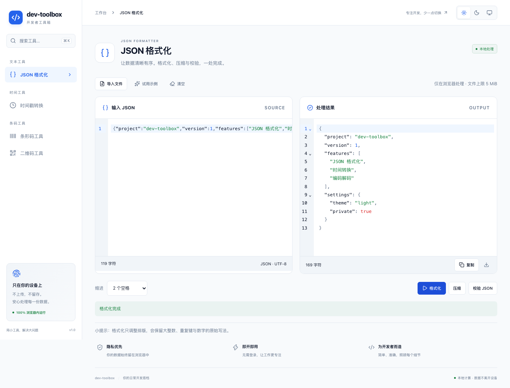

# dev-toolbox

一个纯前端开发者工具箱，提供 JSON 格式化、时间戳转换、条形码和二维码生成与识别。所有数据在浏览器内处理，支持中文界面、深浅主题和响应式布局。

**单文件版可以直接双击使用，无需安装 Node.js、启动终端或运行本地服务。**

[下载单文件](https://github.com/Mr414Zheng/dev-toolbox/raw/refs/heads/main/dev-toolbox.html) · [功能](#功能) · [快速开始](#快速开始) · [开发](#开发) · [测试](#测试) · [扩展工具](#扩展工具)



## 功能

| 工具 | 支持能力 |
| --- | --- |
| JSON 格式化 | 格式化、压缩、严格语法校验、错误行列定位、文件导入、复制和下载；支持 2 空格、4 空格与 Tab 缩进 |
| 时间戳转换 | 秒 / 毫秒与日期时间双向转换，显示本地时区和 UTC，支持负时间戳、ISO 8601 与明确时区偏移 |
| 条形码 | 生成和识别 Code 128、Code 39、EAN-13、EAN-8、UPC-A；验证校验位，支持 SVG / PNG 导出 |
| 二维码 | 编码文本、URL、中文和 Emoji；支持 L / M / Q / H 纠错等级、尺寸设置、SVG / PNG 导出与图片识别 |

- 图片可通过选择文件、拖放或粘贴导入，一张图片最多识别 10 个编码。
- JSON 格式化保留大整数、数字原始写法、键顺序和重复键，不经过对象重建。
- 工具切换保留当前会话的文本草稿；修改输入后，旧结果会标记为过期。
- 导航支持搜索与独立 Hash 链接，主题可选择浅色、深色或跟随系统。

## 快速开始

### 直接打开单文件

1. 下载 [dev-toolbox.html](https://github.com/Mr414Zheng/dev-toolbox/raw/refs/heads/main/dev-toolbox.html)。如果浏览器显示源码，可在 [文件页面](dev-toolbox.html) 选择 **Download raw file** 保存。
2. 用现代浏览器打开下载的 HTML 文件。
3. 开始使用。该文件可单独移动或分享，不依赖项目目录中的其他文件。

单文件约 2.13 MiB，已包含脚本、样式、图标、Worker 和 WASM 解码引擎。首次打开、刷新与切换工具均可完全离线进行。浏览器限制自动复制时，可手动选中结果复制。

请打开 `dev-toolbox.html`；根目录的 `index.html` 是开发入口，不能替代单文件产物。

### 使用限制

| 类型 | 限制 |
| --- | --- |
| JSON | 最大 5 MiB（UTF-8）；接受标准 JSON 顶层值，拒绝注释和尾逗号 |
| 图片 | 单张 PNG / JPEG / WebP；最大 10 MiB、1600 万像素；不接入摄像头 |
| 时间 | 毫秒接受整数，秒最多三位小数；无偏移日期使用所选时区，夏令时重复或不存在的时间需要明确偏移 |
| 条形码 | Code 128 使用可打印 ASCII；Code 39 使用大写字符集；EAN / UPC 可补齐或验证校验位 |

二维码导出尺寸会向上对齐完整模块，以保持边缘清晰。UPC-A 与零前缀 EAN-13 的条纹等价，识别结果可能返回完整 EAN-13，界面会说明对应关系。

## 隐私与离线

- 无后端、账户、遥测、远程字体或 CDN，输入内容和图片不会上传。
- 业务内容不写入持久存储，刷新后清空；仅主题偏好保存在 `localStorage`。
- 识别出的链接按纯文本显示，不会自动打开。
- 单文件版完整离线可用；网站版在相应工具和解码引擎加载后，可在当前会话内离线继续使用。
- 网站版没有 Service Worker / PWA，不保证断网首次访问或刷新可用。

## 开发

### 环境

- Node.js 24
- npm（依赖版本由 `package-lock.json` 固定）

```bash
git clone https://github.com/Mr414Zheng/dev-toolbox.git
cd dev-toolbox
npm ci
npm run dev
```

开发服务器地址以终端输出为准。macOS 也可双击 [启动工具箱.command](启动工具箱.command)，自动启动开发服务并打开浏览器。

### 构建

```bash
# 构建可静态托管的网站版，输出到 dist/
npm run build

# 预览网站版
npm run preview

# 生成可直接双击的独立 HTML，输出到根目录 dev-toolbox.html
npm run build:single
```

仓库保留单文件产物供直接下载。更新功能后，请重新运行 `npm run build:single`，让下载版与源码保持一致。

### 技术栈

| 职责 | 技术 |
| --- | --- |
| 界面与构建 | React、TypeScript、Vite、CSS Modules |
| 导航与图标 | React Router、Lucide |
| JSON 编辑与处理 | CodeMirror 6、jsonc-parser、Web Worker |
| 时间处理 | Temporal polyfill |
| 条码与二维码生成 | JsBarcode、qrcode |
| 图片识别 | zxing-wasm、Web Worker |
| 测试 | Vitest、React Testing Library、Playwright |

## 测试

```bash
npm run typecheck
npm run lint
npm test

# 安装测试浏览器
npx playwright install chromium firefox webkit

# 网站版端到端测试
npm run build
npm run test:e2e

# 单文件离线测试
npm run build:single
npm run test:single
```

测试覆盖数值保真、时间边界与夏令时、条码导出回扫、图片输入和限制、取消重试、主题、响应式布局及子路径部署。

单文件测试将唯一 HTML 复制到临时目录，在断网浏览器中通过 `file://` 打开，并检查没有额外本地文件或 HTTP 请求。浏览器自动化覆盖 Chromium、Firefox、WebKit；系统剪贴板与真实 Safari 交互仍建议在目标设备上检查。

## 项目结构

```text
src/
├── app/                应用布局、工具注册、主题与全局样式
├── shared/             会话草稿、复制、下载和错误边界
└── tools/
    ├── json/           JSON 编辑器与处理 Worker
    ├── time/           时间转换逻辑与界面
    └── codes/          条码生成、图片输入和解码 Worker
scripts/                单文件构建、测试样例与子路径测试服务
tests/                  浏览器测试与固定图片样例
public/                 静态图标
dev-toolbox.html        可直接使用的单文件产物
```

## 扩展工具

导航、搜索和路由统一由 [工具注册表](src/app/registry.ts) 生成。新增工具不需要修改已有工具的业务逻辑。

1. 在 `src/tools/<id>/` 创建模块，默认导出 React 组件，并为转换逻辑补充测试。
2. 在注册表中添加描述，例如导入 `Binary` 图标后注册：

```tsx
{
  id: 'base64',
  title: 'Base64 编解码',
  description: '在文本与 Base64 之间转换。',
  category: '文本工具',
  keywords: ['base64', '编码', '解码'],
  icon: Binary,
  load: () => import('../tools/base64/Base64Tool'),
}
```

3. 使用唯一的 `useDraft` key 保留会话草稿，复用共享组件与语义颜色变量。
4. 重计算放入 Worker，处理取消与旧结果；最后验证网站版和单文件版。

## 静态部署

将 `dist/` 全部内容上传至静态 HTTP/HTTPS 主机即可，无需 Node.js 服务端。相对资源路径与 Hash 路由兼容根路径和子目录，例如 `/toolbox/#/tools/json`，不需要 SPA rewrite。

主机应正确提供 JavaScript、CSS 与 `application/wasm` MIME 类型。若配置 CSP，需允许同源资源、Blob Worker、Blob / Data 图片和 WebAssembly 编译。建议使用 HTTPS，以获得稳定的剪贴板 API 支持。

## 反馈与贡献

欢迎提交 [Issue](https://github.com/Mr414Zheng/dev-toolbox/issues) 或 Pull Request。问题报告请包含浏览器版本、复现步骤和预期行为；示例数据请先去除敏感内容。功能修改请同时验证网站版与单文件版。
